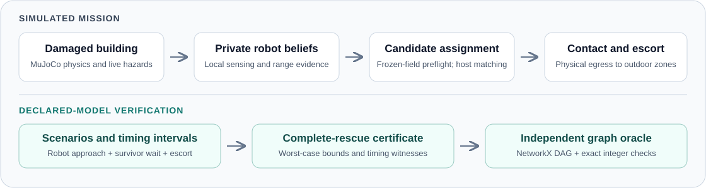

# SwarmRescue

**Simulated search, local contact and survivor escort, with proved bounds for a complete-rescue model.**

[](https://github.com/abhinavgulisetty/SwarmRescue/actions/workflows/ci.yml)
[](pyproject.toml)
[](docs/releases/0.7.0.json)
[](docs/architecture.md)
[](firmware/README.md)

SwarmRescue brings robots and survivor proxies through a damaged building in
MuJoCo. Robots maintain private hazard and localization evidence, establish local
contact, and escort survivors to outdoor safe zones. Native C routing and optional
Cortex-M4 services under QEMU share the same mission workflow.

The research component checks robot approach, survivor waiting and uncertain
escort timing against supplied hazard scenarios. Its exposure bounds have a
mathematical proof and independent graph verification. The simulator integrates
a frozen-belief specialization into assignment; the model proof does not certify
executed physical dose.

[Delivery report](RESEARCH_DELIVERY.md) · [Model proof](docs/research/lag-rescue/method.md) · [Architecture](docs/architecture.md) · [Portable installation](outputs/releases/0.7.0/INSTALL.md) · [Reproduction guide](docs/reproducibility.md)



## Verified results

| Check | Recorded result | Evidence |
| --- | --- | --- |
| Independent exact integer comparisons | **288**, zero mismatches | [Study results](docs/research/lag-rescue/results.json) |
| Complete scenario/timing replays | **5,352**, all selected rescues within both budgets | [Protocol and proof](docs/research/lag-rescue/method.md) |
| Physical simulation acceptance | **5/5 runs passed** across three seeds, ARM routing and a distance-assignment control | [Acceptance summary](outputs/releases/0.7.0/validation/summary.json) |
| Native / ARM agreement at seed 42 | **8/8 evacuated** in each; eight recorded fields identical; **26 ARM requests** | [Paired comparison](outputs/releases/0.7.0/validation/native-arm-comparison.json) |
| Cleaned checkout regression suite | **872 passed**, zero failures or skips; Ruff clean | [Cleanup validation](outputs/verification/cleanup-2026-10-19/summary.json) |
| Frozen 0.7.0 release regression suite | **933 passed**, zero skips | [Immutable release receipt](docs/releases/0.7.0.json) |

The two test counts describe different snapshots: cleanup removed historical
experiments and their tests while preserving the frozen release evidence. Both
recorded regression runs had the ARM toolchain enabled.

The original-author stochastic-hazard allocation implementation was also run
unchanged at a pinned commit, reproducing its supplied objectives and episode
scores. Its task differs from survivor escort, so those scores are not a matched
superiority comparison. See the [reproduction report](docs/research/external-rescue/reproduction.md).

## Quick start

Python **3.12 on Linux** is the validated environment. Install
[`uv`](https://docs.astral.sh/uv/getting-started/installation/), then:

```bash
git clone https://github.com/abhinavgulisetty/SwarmRescue.git
cd SwarmRescue
uv sync --frozen --python 3.12 --extra dev
.venv/bin/python -m swarmrescue.cli doctor
.venv/bin/python -m swarmrescue.cli rescue --report outputs/rescue/source-mission.json
```

The preset runs eight robots at seed 42 with private hazard beliefs,
receiver-local range evidence, complete-rescue assignment and physical
evacuation. It runs without rendering by default. The first run for a new
building can take several minutes to simulate and cache collapse.

Useful options:

```bash
# Smaller checked mission
.venv/bin/python -m swarmrescue.cli rescue --seed 7 --robots 4

# Render and record the mission
.venv/bin/python -m swarmrescue.cli rescue --render --speed 2 --fps 12

# Matched distance-assignment control
.venv/bin/python -m swarmrescue.cli rescue --rescue-assignment distance
```

For an isolated installation, use the
[portable release bundle](outputs/releases/0.7.0/swarmrescue-0.7.0-complete-rescue.tar.gz)
and its [installation instructions](outputs/releases/0.7.0/INSTALL.md). The bundle
contains the wheel, dependency lock, proof, source archives and verification
receipts. The installer can build and probe optional ARM/QEMU routing workers;
the [firmware guide](firmware/README.md) explains the required tools.

## Reproduce the checks

```bash
# Focused certificate, assignment and independent-oracle regressions
.venv/bin/python -m pytest -q tests/test_rescue_certificate.py tests/test_rescue_planning.py tests/test_lag_rescue_validation.py

# Rebuild the independent graph study
.venv/bin/python -m swarmrescue.cli certificate-evaluation --output-dir outputs/certificate-evaluation

# Active regression suite and lint
.venv/bin/python -m pytest -q
.venv/bin/ruff check .
```

The independent oracle materializes stage/time graphs and calls NetworkX's
longest-path solver; it does not call the optimized certificate recurrence.
Python integer edge weights check the exact integer entrypoint. The frozen
[protocol](docs/research/lag-rescue/protocol.json),
[results](docs/research/lag-rescue/results.json) and
[source-archived mission reports](outputs/releases/0.7.0/validation/) identify what
was tested. ARM-dependent checks require the toolchain described in the firmware
guide.

## Scope and limitations

The proof covers the supplied discrete hazard scenarios and bounded timing
intervals. Physical preflight uses a temporally frozen private routing-cost
field with exposure thresholds disabled. Routes and geometry can change during
execution, so preflight does not establish an executed physical-dose bound.

Historical originality remains unestablished; the
[independent literature audit](docs/research/independent-novelty-2026-10-16.md)
identifies inherited methods and the closest prior work. Human survival,
calibrated sensor/hazard containment, whole-robot MCU memory and physical-board
timing remain open. Assignment and geometry management run on the host.

## Repository map

| Path | Purpose |
| --- | --- |
| [`cascade/`](cascade/), [`hazard/`](hazard/) | Buildings, collapse, environment and physics |
| [`ember/`](ember/) | Private beliefs, radio/localization, planning, certificate and escort |
| [`mcu/`](mcu/), [`firmware/`](firmware/) | Integer kernels and native/ARM routing services |
| [`swarmrescue/`](swarmrescue/) | Installed CLI, mission preset and deployment |
| [`eval/`](eval/), [`tests/`](tests/) | Independent checks, supported evaluations and regressions |
| [`docs/research/`](docs/research/), [`docs/releases/`](docs/releases/) | Proof, prior-art audit and frozen evidence manifests |

The [cleanup manifest](docs/cleanup-2026-10-19.json) records the removal of obsolete
experiments and generated material from the active checkout. Some retained
historical evaluation helpers require separately supplied inputs; use
`certificate-evaluation` for the current proof study.
