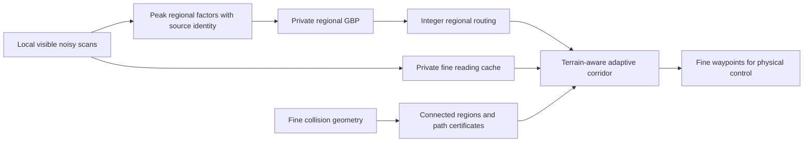

# Connected-region architecture experiments — 2026-10-04

With the experimental mode enabled, each robot has a two-level planner: regional GBP and integer routing, plus direct visible fine-cell readings for terrain-aware path refinement. The flat architecture remains the default; compact inference is opt-in with `--region-cells 4`. These three layouts are disclosed development experiments with one radio/sensor replicate each, not sealed or statistical generalization evidence.

| Seed | Architecture | Sites reached | Numeric peak bytes | Radio air bytes | Full-mission exposure proxy | Search-until-arrival exposure proxy | Last arrival seconds | Peak host refinement nodes | Geometry revisions | Rejected factor attempts |
|---:|---|---:|---:|---:|---:|---:|---:|---:|---:|---:|
| 7 | flat | 4/4 | 984,756 | 16,352 | 239.260655 | 44.332045 | 36.652 | 0 | 12 | 20702 |
| 7 | region4 | 4/4 | 145,245 | 15,536 | 227.402088 | 36.683948 | 45.060 | 5228 | 10 | 0 |
| 19 | flat | 8/8 | 1,002,658 | 26,976 | 671.303282 | 650.557918 | 28.230 | 0 | 4 | 0 |
| 19 | region4 | 8/8 | 130,952 | 27,584 | 673.602695 | 652.876184 | 29.380 | 5258 | 4 | 0 |
| 42 | flat | 8/8 | 898,100 | 39,008 | 23.517286 | 21.335645 | 29.018 | 0 | 6 | 4065 |
| 42 | region4 | 8/8 | 150,272 | 36,416 | 23.830171 | 21.652159 | 30.562 | 4229 | 6 | 0 |

Exposure is sampled independently from simulator truth at robot body height plus 0.3 m. Heat and smoke contributions use the existing oracle cost weights, exclude base step cost, and integrate at the hazard cadence. Full-mission dose includes waiting after arrival; search dose stops accruing once a robot reaches its assigned site. The current PDE has no outdoor field, so out-of-domain dose is modeled as zero. Neither metric is calibrated ISO tenability or physical patient evacuation.

## Architecture and invariants



- Cells merge only if they are connected within the same spatial block and vertical voxel level. Every regional edge has an explicit path through valid fine edges.
- Regional scans retain the hottest measured cost in each region with the selected sample variance. More samples do not artificially shrink that variance. Delivered hotspot floors prevent cooler peers from washing out a hazard.
- Peak pooling is biased and is not a calibrated Gaussian regional maximum. The original exact C1 Gaussian derivation is not claimed for this approximation.
- Fine readings retain direct local measurements only, in nine arena bytes per fine cell; peers do not share a full posterior. Refinement preserves terrain difficulty and widens a modeled time-infeasible corridor.
- Geometry changes discard regional factors when membership or surface heights change. Surviving direct fine readings transfer by exact voxel/height identity with process-variance aging.
- Live geometry refresh triggers on accumulated box-corner displacement of half a voxel since the last snapshot, rate-limited to two seconds while robots are unfinished. The observer includes rotation, sign-invariant quaternions, and removed members. It uses simulator structural poses already used by rasterization, not a deployed lidar implementation.
- Physical robots explicitly reject an entire new packet if its unseen factors do not fit provenance capacity. Accepted factor identities are never evicted, so delayed duplicates cannot be fused twice. This is lossy backpressure: prolonged observation can freeze inference on stable cells. Dropped-factor counts are attempts, not necessarily unique observations. Geometry transfer preserves these counters.
- Region numeric capacity is checked before allocation against 200 KiB. It includes retained GBP, fine cache, hotspot floors, integer routing and bounded deadline labels. Oversized partitions fail rather than silently expanding the arena.

## Failures and corrections

The first peak-only seed-7 candidate reached 4/4 sites using 92,004 numeric bytes, but full-mission exposure rose from 219.518346 to 226.016518. It was not promoted. Three fixed-label deadline allocations failed: regional seed 42, regional seed 19 and flat seed 19. Their failure manifests and source snapshots are retained under `outputs/demo/architecture-regional/*oom-v1*`.

Adding a compact direct fine-reading layer resolved within-region hazard aliasing, but the second seed-42 candidate reached only 7/8 sites. Its refinement had discarded terrain difficulty and routed onto rubble. The third version preserves that cost and expands infeasible corridors; both eight-robot layouts then passed. Seed 7 exposed a separate controller handoff failure: replanning the identical remaining route with a measured-pose prefix reset projection and progress. Preserving that state was necessary but insufficient: version 4 still reached only 3/4 in seed 7. A single collapse snapshot allowed later rubble motion to invalidate a route. Version 5 adds repeated movement-triggered map refresh and reaches 4/4 and 8/8 with compact inference, but both flat controls exhaust provenance and abort. Version 6 retains the refresh and explicitly rejects new packets on factor-capacity exhaustion, preserving accepted source identities and counting the rejected factor attempts. It also stops pose-triggered navigation refresh after every robot arrives. The failed `seed42-region4-v2.json` and `seed7-region4-v3.json` and their source archives remain available.

## Selection decision

Completion takes priority over exposure. Rejected candidates remain archived; the default stays flat because three development layouts do not establish regional model accuracy, generalization, whole embedded RAM compliance or exposure superiority. Repeated refresh increases traffic and is not a communication-efficiency improvement over the earlier one-snapshot protocol. The two paired methods share the final refresh lifecycle, sensor/noise streams and source state.

## Validation and completion boundaries

All 501 tests and runtime Ruff pass. Tests cover connected-component preservation, edge certificates, hotspot retention, duplicate handling, occlusion-isolated caches, within-region clear-path selection, terrain penalties, corridor expansion, evidence invalidation, cache aging, hard numeric limits, zero/partial deadline scratch budgets, the captured unchanged-route controller regression, rotation-aware geometry invalidation, and lossless duplicate history under explicit packet rejection. Native integer conformance remains covered.

The whole embedded-memory gate remains open: fine-map construction, graph storage, certificate tables, raycast sensing, sparse adjoints, refinement heaps and scratch, packet/provenance Python metadata and runtime are outside the numeric arena. Corridor widening may reach the full fine connected component, as the peak-node column discloses. This is a host architecture prototype, not a complete MCU deployment.

Centralized BLE, ground-level-only search, host-observed structural poses rather than deployed ranging, uncoupled hazard geometry, incomplete sensors and uncalibrated tenability remain. Learned acceleration, emulator timing and real firmware control are unfinished. No whole-project completion or new completion percentage is claimed.

Hierarchical planning was considered alongside full-map compression and replacing GBP with a mean-only linear solver. Connected abstraction preserves explicit geometry paths; a mean-only solver would change covariance semantics. Background: [DHPA*/SHPA* primary paper](https://ojs.aaai.org/index.php/AIIDE/article/view/12397) and [Gaussian BP walk-sum analysis](https://papers.neurips.cc/paper_files/paper/2005/hash/ade55409d1224074754035a5a937d2e0-Abstract.html). These experiments do not claim a new hierarchy algorithm or exact fine-model equivalence.

## Reproduction

```bash
.venv/bin/pytest -q
.venv/bin/ruff check cascade ember eval hazard mcu tests
.venv/bin/python -m cascade.demo --seed 42 --robots 8 --compact --live-disaster --distributed --region-cells 4 --no-render --report outputs/demo/architecture-regional/replay.json
# Set --region-cells 0 for the flat control.
```

## Source provenance

All six evaluated reports and source bundles have the same source base commit and dirty-source hash. Each run checks that its source stays unchanged. Artifacts are generated locally under ignored `outputs/`; this tracked report includes their archive hashes.

- `outputs/demo/architecture-regional/seed7-flat-v6.json`; matching `.source.tar.gz` SHA-256 `c22ef913b478ea47613f96f73e91afb0849492a27100a45cfeb2335a78897e79`.
- `outputs/demo/architecture-regional/seed7-region4-v6.json`; matching `.source.tar.gz` SHA-256 `0314b66db7fce2fd0b373a0becdb62b037e6a9d7b30d3d768fde410a16601981`.
- `outputs/demo/architecture-regional/seed19-flat-v6.json`; matching `.source.tar.gz` SHA-256 `ff47ae3287da90afc86624cbd82f2ae55fc44dde1e9ff452d52e1289563d35a8`.
- `outputs/demo/architecture-regional/seed19-region4-v6.json`; matching `.source.tar.gz` SHA-256 `523324ec5d41c80cbc91daba5812196e02a62ed0c8b92e119583d23dd4a6f7d0`.
- `outputs/demo/architecture-regional/seed42-flat-v6.json`; matching `.source.tar.gz` SHA-256 `2b7a06dc15c3991c9b54b4d13566f94a6bede55533a768eb8ee7600b0f20fc18`.
- `outputs/demo/architecture-regional/seed42-region4-v6.json`; matching `.source.tar.gz` SHA-256 `dfb692bc97ece07fc3fb31628d6883f34439eff4733cfdb4db88bd8600f9e77a`.

## Reviewed physical clip

The final regional seed-7 clip is `outputs/demo/architecture-final-v6/compact/seed7_end_to_end.mp4`: 528 decoded frames, 12 fps, 44 seconds, 1920×1080. Intermediate and terminal frames were visually reviewed. The previously blocked robot reaches its target at 45.060 simulated seconds; all four targets are reached before the 48-second mission end. The end card reports site arrival, not patient evacuation.
