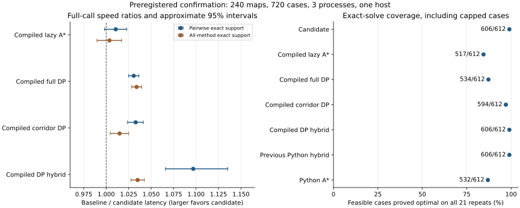

# Independently Checkable Evidence for Arena-Limited Deadline Routing

Research draft, 11 October 2026. Author names, affiliations, funding and target
venue must be supplied before submission. This manuscript reports a scoped
implementation study; algorithmic novelty and wider deployment generalization
remain open publication work.

## Abstract

Static egress routing can require minimizing an estimated exposure objective
subject to a hard discrete traversal budget. We study an adaptive host solver
combining lexicographic shortest-path certificates, verified unit-duration FIFO
processing, clipped consistent lower bounds, lazy resource-constrained A*, and
full or packed dynamic programming under a 200 KiB numeric scratch arena. We
give correctness arguments for its safe transformations and exact completion,
and provide independently checkable Bellman certificates for 72 held-out maps.
All 2,808 saved solver result records satisfy the witness/claim checks; the
candidate proves 196 of 198 feasible cap-specific optima, with two honest
fallbacks on one map. A separate bounded exhaustive study validates 338,044
solver calls against simple-path enumeration. The original evaluation estimates
a 1.044× geometric-mean speed ratio relative to compiled lazy A* on 171 mutually
exact cases, with meaningful input-level losses. A fresh preregistered replication
on 240 maps verifies 105,840 repeats across three process sessions. It does not
confirm a speed advantage over compiled lazy A*: its ratio is 1.011× with an
approximate 95% interval [0.998,1.023]. It does show higher finite-corpus exact-solve
coverage under the common arena: 606/612 feasible cases versus 517/612. Against
the previous Python hybrid, equivalent exact coverage accompanies a 6.707×
speed ratio [6.328,7.101]. Results concern the
declared static estimated-cost model and host routing latency, not universal
solver dominance, complete embedded memory usage or physical rescue survival.

## 1. Problem and contribution

For a finite graph with positive integer arc cost c, positive integer traversal
duration t, start s, goal set Z and deadline D, we minimize total c subject to
total t<=D. Public input has undirected topology but directed arrival-risk
costs. An arc's duration is a conservative tick count, and its estimated
objective combines length and arrival-node risk before positive Q16 rounding.
Neither the static risk estimate nor the traversal model captures all dynamics
of an actual evacuation.

The artifact contributes an arena-limited implementation and a reproducible
evaluation of full routing calls, supplemented by explicit proofs and finite
instance certificates. Ordinary shortest-distance routing is an inadequate
comparator because it optimizes a different objective. We instead compare
matched constrained solvers with the same cost, clock, graph, observations and
numeric scratch ceiling. We do not claim that the standard constituent
algorithms, dominance arguments or Bellman recurrence are new.

## 2. Related work

Resource-constrained shortest paths have specialized heuristic search methods.
[Ahmadi, Raith and Jalili (ESA 2025)](https://drops.dagstuhl.de/entities/document/10.4230/LIPIcs.ESA.2025.97)
study heuristic-guided constrained search with efficient queuing and pruning,
including a broader setting than this artifact's positive single-resource
model. [Ahmadi et al. (AAAI 2025)](https://ojs.aaai.org/index.php/AAAI/article/view/34892)
develop enhanced bidirectional A* with constrained-search pruning. Our current
candidate does not implement their bidirectional framework, and our synthetic
egress workloads do not substitute for their large network evaluations.

For systems evaluation,
[Kalibera and Jones (2013)](https://kar.kent.ac.uk/33611/) motivate accounting
for uncertainty at multiple repetition levels. We report process-level and
map-level variation explicitly. Post-hoc original-evidence diagnostics use
[Holm's procedure (1979)](https://www.ime.usp.br/~abe/lista/pdf4R8xPVzCnX.pdf)
for twelve comparisons under the diagnostic tests' assumptions. Correction
does not remove selection bias or compensate for missing timing-repeat statuses.
A wider priority review remains necessary before an algorithm-novelty claim.

## 3. Implementation

Each full API call validates input, quantizes costs and durations, sorts
transitions into CSR, and allocates fresh storage. Reverse topology and clocks
are shared where symmetry permits, while reverse arrival-risk weights differ.
No result or graph cache benefits repeated queries. The C99 kernel is compiled
with `-O3`; compilation and import warmup are excluded for all measured methods.

Fastest and cheapest lexicographic certificates can terminate the problem
immediately. Verified unit-duration graphs use FIFO layering for the time
certificate. Weighted graphs retain heap Dijkstra. Early-stop fields preserve
consistent scalar bounds by clipping unknown distances to the settled start
threshold; unknown secondary values do not supply invented suffix witnesses.

The candidate selects full DP when |V|*(D+1)<=8192. Otherwise it uses lazy A*
with a caller label quota, admissible feasibility/cost pruning and known suffix
incumbent updates. On interruption, full or packed DP is attempted if it fits.
The packed corridor retains only remaining budgets compatible with forward
minimum duration and reverse admissible duration. A bounded fallback preserves
a feasible incumbent when possible and marks incomplete exactness explicitly.

The numeric arena is checked by the allocator and result verifier. It excludes
CSR inputs, route outputs, Python objects, the C stack and third-party process
RAM. The deadline kernel runs on the host; the existing Cortex-M4 Bellman service
is a separate unchanged component. The implementation is therefore not a
measured embedded deadline-solver result.

## 4. Correctness and proof witnesses

[The full appendix](proofs.md) establishes that positive-cost optimal routes
can be simple, lexicographic certificates support exact early decisions,
unit-clock FIFO preserves cost ties, fixed-threshold clipping preserves
consistency, and lazy dominance is safe under a fixed consistent heuristic.
Uninterrupted A* completion and fitting DP are exact. Packed states retain all
feasible root completions. Resource interruption establishes only an incumbent
and its valid lower-bound gap, not automatic optimality.

For remaining budget b, a certificate gives F(z,b)=0 for every goal and

    F(u,b) = min { c(u,v)+F(v,b-t(u,v)) : t(u,v)<=b }.

Positive durations make dependencies acyclic in b. A small independent checker
uses arbitrary-precision integers to verify every equality, then checks each
claimed feasible route's arcs, cost and duration and compares exactness claims
against F(s,D). It imports neither the production solver nor its benchmark
oracle. The certificates prove the embedded finite models; source and input
digests additionally bind the regenerated original corpus to the sealed report.
This is not a formal verification of all C/Python executions.

Q16 optimality concerns the discrete estimated objective. The appendix bounds
quantization regret on the same feasible set by 3*(|V|-1)/(2*65536), including
the positive-cost clamp, under its numeric assumptions. Deadline rounding may
exclude continuous-feasible paths, and neither bound addresses estimation error
or physical mission dynamics.

## 5. Original held-out evaluation

The original protocol was committed before evaluating seeds 82000–82011.
Six families and label capacities 32, 128 and 4096 give 216 cases from 72 maps,
including 198 feasible cases from 66 feasible maps. Families cover grids, room
graphs, dense graphs, dead ends, deliberate risk/time tradeoffs and larger
grids. Development seeds are separate. Every method uses identical information
and a 200 KiB numeric scratch ceiling.

Five fresh full-call samples are measured per method in randomized method order.
Exact timing pairs require matching proved feasible optima. Ratios below are
geometric means of baseline latency divided by candidate latency; values above
one favor the candidate. Confidence intervals are the original 3,000-draw
whole-map-seed bootstrap intervals. Repeated capacities are not independent
samples. Pairwise support differs across methods.

| Comparator | Exact pairs | Speed ratio | Original 95% CI |
|---|---:|---:|---:|
| Python A* | 174 | 5.901× | [5.500, 6.348] |
| Previous Python hybrid | 196 | 6.901× | [6.230, 7.542] |
| Compiled lazy A* | 171 | 1.044× | [1.015, 1.076] |
| Compiled full DP | 174 | 1.055× | [1.037, 1.075] |
| Compiled corridor DP | 195 | 1.066× | [1.043, 1.088] |
| Compiled DP hybrid | 196 | 1.090× | [1.060, 1.129] |
| Native HiGHS MILP | 190 | 82.684× | [72.236, 94.420] |

The remaining Pareto and Python lazy/dual/DP comparators and all raw observations
are retained in [the original release](../native-deadline-release.md). The
compiled comparators share compiler flags and CSR preprocessing with the
candidate, reducing the interpretation problem of a Python-versus-C headline.
The external authors' NWRCA* implementation is supplementary: its initialization
and search timer differs from candidate full-call timing, and bucket setup on
small egress graphs limits generalization. Its 127.86× reported ratio is not the
main claim of this paper.

Candidate numeric scratch peaks at 204,788 bytes under the 204,800-byte limit.
Every candidate objective matches the previous hybrid in this corpus. Two
large-grid cases, both seed 82003 at small label quotas, have cost 30,411,713
versus optimum 20,092,115 in Q16 units: 51.36% above optimum. They are not counted
as exact speed wins. The oracle optimum is proved at capacity 4096.
HiGHS has three unresolved feasible cases under its three-second limit.

Compiled A* wins 49 of 171 exact pairs. Candidate family ratios are 0.959× on
rooms and 0.961× on tradeoffs, versus 1.153× on dead ends and 1.190× on large
grids. No per-family or per-input universal win is supported.

## 6. Independent audit and bounded exhaustive checks

The original audit verifies 1,095,724 Bellman states and every one of 2,808 saved
result contracts, including unresolved statuses. Source hashes and regenerated
input digests match the frozen protocol. Actual routes are checked independently
instead of trusting the reported objective alone.

On pairwise exact support, a seed-level sign-flip diagnostic gives a Holm-adjusted
p-value of 0.01855 against compiled A*. This is post-hoc, assumes symmetric
independent null seed effects, and has eleven informative timing seed blocks.
Leaving out one seed gives ratios 1.034–1.053. However, the 81 cases where every
baseline solves exactly give a compiled-A* ratio of 1.023 with an approximate
95% interval [0.992,1.060]. This sensitivity limits an unqualified conclusion.
Moreover, the original report preserves only the last repeat's status, so exact
eligibility for all five timing repeats cannot be reconstructed.

Bounded exhaustive verification enumerates every symmetric graph on 1–4 nodes
whose edges are absent or have (duration,cost) in {1,2}², with start 0, last-node
goal and deadlines 0–6. It checks 330,876 calls across three native strategies
against independently enumerated simple paths. A second domain adds 7,168
public-API calls with unit edge lengths, binary arrival risks and multiple exits.
All 338,044 calls match. This domain exercises small exact decisions, not large
clocks, label exhaustion or full C memory safety; earlier randomized and sanitizer
validation remains complementary evidence.

## 7. Fresh preregistered confirmation

The protocol in commit `6be1fd6` fixes seeds 92000–92039 before opening them,
retaining the existing candidate unchanged. Forty seeds × six families × three
capacities yield 720 cases from 240 distinct maps. Seven methods run seven
repetitions in each of three sequential process sessions, with map, capacity
and per-round method order randomized. Verification is outside timed intervals.
Every sample preserves its route, status, objective, arena peak and latency.
Imports and compilation use a development case outside measured calls.

The primary comparison is compiled lazy A*. Eligibility requires both methods
to prove the same feasible optimum in every one of 21 repeats. The estimator
equally weights case log ratios and processes, using each process's seven-call
median. A preregistered approximate hierarchical bootstrap resamples whole
process sessions and whole map-seed blocks; it retains related families and
capacities. The primary rule confirms an average advantage only when the lower
endpoint of its 95% interval exceeds one. Secondary results include six-way
approximate simultaneous intervals, quality coverage and common-success support.

All three registered sessions completed. Independently checking every sample
verifies **105,840 result contracts** and **12,103,650 Bellman states**, including
repeated copies of each model across the processes. There are 612 feasible and
108 infeasible cap-specific cases. The primary rule **does not confirm** an
average speed advantage over compiled A*: the interval includes one. The
candidate was not tuned after observing these results, and the primary
comparator was not replaced.

| Comparator | Exact pairs on all repeats | Speed ratio | Approximate hierarchical 95% CI | All-repeat optima / 612 feasible cases |
|---|---:|---:|---:|---:|
| Compiled lazy A* (primary) | 517 | 1.011× | [0.998, 1.023] | 517 |
| Compiled full DP | 534 | 1.031× | [1.025, 1.036] | 534 |
| Compiled corridor DP | 594 | 1.033× | [1.024, 1.041] | 594 |
| Compiled DP hybrid | 606 | 1.097× | [1.066, 1.135] | 606 |
| Previous Python hybrid | 606 | 6.707× | [6.328, 7.101] | 606 |
| Python A* | 532 | 5.673× | [5.465, 5.897] | 532 |

The candidate proves 606/612 feasible optima on every repeat (99.02%). Compiled
lazy A* proves 517/612 (84.48%): the candidate proves all these cases and an
additional 89, a 14.54 percentage-point coverage difference on this corpus.
Both return feasible routes for all 612 cases. Their worst returned objective
gaps are 34.80% and 464.96%, respectively. These are measured finite-corpus gaps,
not global approximation factors. The previous Python hybrid and compiled DP
hybrid also prove 606/612, so the candidate has no coverage advantage over those
comparators here.

Against compiled A*, process ratios are 1.012, 1.005 and 1.014. The candidate
loses 164/517 pairs after averaging process log ratios. Family ratios include
0.894 on rooms, 0.965 on tradeoffs, 1.082 on dead ends and 1.158 on large grids.
On the 492 cases solved exactly by every measured method, the compiled-A*
ratio is 1.004 [0.990,1.017], again compatible with a tie.

Approximate Bonferroni simultaneous intervals across six comparisons also
include a tie for compiled A*, [0.994,1.027]. They exclude a tie for the other
five comparators: full DP [1.022,1.038], corridor DP [1.020,1.044], DP hybrid
[1.059,1.151], previous Python hybrid [6.203,7.239] and Python A* [5.396,5.980].
These secondary results do not rescue the failed primary endpoint or establish
universal dominance.

Figure 1. Full-call geometric-mean latency ratios with approximate process-and-
seed 95% intervals. The second support definition retains only cases every
method solves exactly. The coverage panel includes all feasible cases and
requires exactness on every repeat. Ratios above one favor the candidate;
intervals crossing one are compatible with a tie. All measurements use one
physical host and exclude compilation and process startup.

[Complete summary](confirmation-summary.json), [CSV table](confirmation-table.csv),
and [process 0](confirmation-process-0.json.gz), [process 1](confirmation-process-1.json.gz),
[process 2](confirmation-process-2.json.gz) preserve the full evidence. Every
unfavorable result is included.

## 8. Limitations and publication scope

The original and confirmation studies are synthetic/static workloads on one
physical host. Three process sessions provide process-level variation, not
three independent machines. Success-conditioned ratios can favor different
subsets, so quality, failures and common support must accompany latency. Bootstrap
inference is approximate. The implementation remains memory-limited on some
instances and offers no universal speed or fixed-memory optimality theorem.

Component ablations are still needed before attributing improvements separately
to FIFO, clipped fields, suffix updates or the adaptive selection rule. Public
realistic-network workloads, deadline and memory sweeps, independent-machine
replication and a fuller literature review would strengthen generalization and
novelty. Local git preregistration should be deposited in a durable timestamped
archive before submission, with code and raw evidence.

Installed seed-42 native and live ARM service missions evacuate 8/8 survivors,
but their measured physical outcomes match the previous release. They establish
regression behavior, not improved survival or evacuation time. Such a claim
requires matched multi-seed mission experiments with equal observations and
hazard information. The present paper can report scoped routing guarantees and
empirical host latency, with these limits stated explicitly.

## Artifact availability

[Reproduction instructions](README.md), [claim ledger](claims.md),
[proof appendix](proofs.md), [original audit](evidence-audit.json),
[standalone certificates](instance-certificates.json.gz),
[exhaustive receipt](exhaustive-checks.json) and [BibTeX references](references.bib)
are provided in this repository. The original raw benchmark remains unchanged.
The standalone checker requires only the Python standard library; executing
native experiments additionally requires the project environment and a C compiler.
