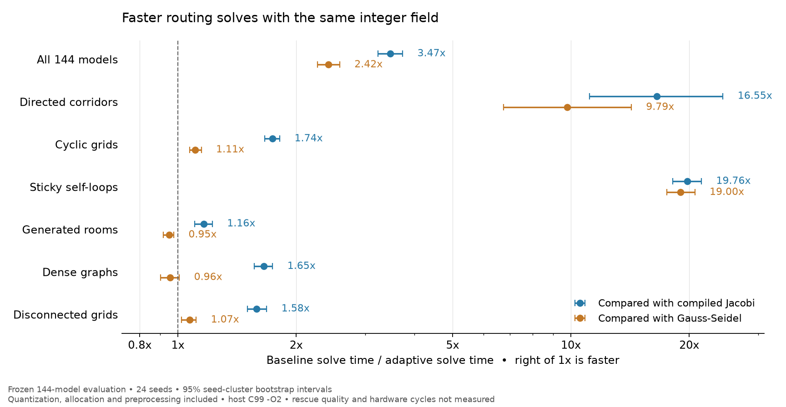

# Exact integer routing acceleration

This work targets the deployed negative-log Q16 Bellman solver. It does not
claim that EMBER beats every navigation system, or that faster field iteration
improves survivor outcomes. Algorithms must be compared on the same problem
before their timings support a claim.

## Research and implementation

[Todorov's original LMDP paper](https://papers.nips.cc/paper_files/paper/2006/file/d806ca13ca3449af72a1ea5aedbed26a-Paper.pdf)
motivates the desirability formulation already used by EMBER.
[Moore and Atkeson's prioritized sweeping](https://publications.ri.cmu.edu/prioritized-sweeping-reinforcement-learning-with-less-data-and-less-real-time)
motivates the implemented residual queue baseline. The new solver combines
established shortest-path bounds and ordered Gauss–Seidel updates; it is not
presented as a novel invention of these algorithms.

[SIPP](https://www.cs.cmu.edu/~maxim/files/sipp_icra11.pdf) and
[A*+T](https://arxiv.org/abs/2504.19593) address time-dependent planning problems.
They are relevant to future hazard forecasting and multi-agent comparisons,
but solve different objectives from a static integer LMDP field. They are not
included as speed baselines for this solver, and no superiority over them is
claimed. Time-dependent rescue planning requires a separate causal prediction
model and trajectory evaluation.

The seven explicit C schedules are synchronous Jacobi, natural-order
Gauss–Seidel, path-bound Jacobi, path-bound ordered Gauss–Seidel, residual
prioritized sweeping, path-bound prioritized sweeping, and exact conditional
self-loop updates in path-bound order. An eighth `auto` strategy chooses
natural-order Gauss–Seidel when average CSR degree exceeds 12 and no
nonterminal self-loop has negative log probability at most 6905 Q16 units;
otherwise it chooses bound-ordered updates, with conditional updates when
a sticky self-loop exists. This avoids a per-row self-loop scan on ordinary
graphs. This rule is chosen using the
development set, before evaluation. All share the
same row operator, LUT interpolation, saturation, absorbing boundary masks,
edge folding order, and deterministic policy extraction.

For a row `i`, the soft-min backup is at most any individual finite edge term
plus the state cost. Reversed Dijkstra uses weights
`cost[i] + negative_log_passive[i,j]` to calculate a path-to-exit upper bound.
It seeds iteration with a supersolution. Because the integer row operator is
monotone, decreasing fair iterations from that bound reach the same greatest
integer fixed point as iterations from infinity. Ordered updates visit lower
path bounds first. No extrapolation or approximate stopping tolerance changes
the solution. Capped intermediate fields can differ between schedules.

For sticky self-loops the conditional solver searches for the **greatest**
integer root with every other state held fixed. It bisects the predicate
`backup(x) >= x`, preserving rounding-induced fixed-point plateaus rather than
choosing an arbitrary root. A preliminary ordinary backup bounds the search.
If any self term crosses the integer saturation boundary, the row safely
uses an ordinary update. Otherwise soft-min translation invariance and
monotonicity make the predicate monotone. This accelerates the slow diagonal
feedback while retaining the original quantized equation.

Individual path bounds can saturate even when combined soft paths remain
finite. These states stay in the update order. Reachability is determined by
the converged field, not by Dijkstra's saturated bound.

All graph, heap and iteration buffers are caller-owned. The queue holds at most
one entry per state. Statistics count Bellman row evaluations and reverse edges
visited; a prioritized "sweep" is an applied-update budget equivalent, not a
synchronous sweep. Exhausting a cap returns `fixed_point=false`.
Reverse CSR entries pack source and original edge indices into one uint32
when `N*M <= UINT32_MAX`, with a two-word fallback for larger models. Packing
preserves the original CSR row folding order. No heap allocation or libc
memory functions are needed in the freestanding C kernel.

## Evaluation boundaries

`python -m eval.solver_benchmark` runs matched cold-start solves. Compilation
is excluded for every method. Kernel timing includes C model validation,
reverse graph construction, heap preprocessing, and iteration. End-to-end
timing additionally includes model quantization and arena allocations.
All methods use C99 with identical `-O2` flags. Method order is randomized.
Each timing is a median of five batched samples; full samples are retained.

Inputs include directed corridors with randomized numbering, cyclic grids,
sticky self loops, blocked procedural room graphs, dense graphs, and
disconnected components. These are solver workloads, not physical rescue
trials. Room costs are seeded synthetic fields, not measured human danger.
Every converged field must match reference Jacobi bit for bit. Failures are
retained rather than dropped as fast solves.

Development seeds are 31000–31011. Evaluation seeds are 41000–41023, separately
declared for this change. The implementation and deployment choice must be
frozen before opening the evaluation set. Timing confidence intervals resample
seed clusters so six families from a seed are not treated as independent
worlds. They measure this machine and workload distribution, not all hardware.

## Frozen solver results

All 144 candidate solves across 24 fresh evaluation seeds and six graph families
converged to the same reference integer field. The final development comparison
also passes all 72 models. Full timing samples, input fingerprints and failure
records are preserved in [compressed evaluation data](benchmarks/solver-evaluation.json.gz),
[development data](benchmarks/solver-development.json.gz), and the
[summary receipt](benchmarks/solver-summary.json).

| Matched baseline | Kernel geometric-mean speedup | Full-solve geometric-mean speedup | Full-solve 95% CI | Faster full solves |
| --- | ---: | ---: | --- | ---: |
| Compiled Jacobi | 5.62x | 3.47x | [3.23, 3.73] | 141/144 |
| Compiled natural-order Gauss–Seidel | 3.41x | 2.42x | [2.27, 2.58] | 100/144 |

The primary speed metric includes quantization and arena allocation. Kernel
timing includes graph preprocessing. Both primary baselines converge on all
models. The chart shows family-level regressions rather than hiding them:



Sticky-loop problems improve by 19.76x against Jacobi and 19.00x against
Gauss–Seidel in full-solve timings. Room graphs and dense graphs average 0.95x
and 0.96x against Gauss–Seidel: the adaptive solver is about 4–5% slower there.
Its worst individual full-solve ratio against Gauss–Seidel is 0.678x.
This is an average efficiency win on the declared distribution, not dominance
on every case. The original learned NCA hypothesis remains a separate result.

Both residual-priority baselines exhaust their applied-update caps on 13
evaluation models. Their timing ratios use 131 successful pairs and must not
be reported as an all-model comparison. Failures, update counts, memory use and
individual timing samples stay in the archived reports.

The report's C source hash is
`93a489022c4558172d6b105da7a6704eeb10fc7a2b7dc9f53f365027b3e1c5b7`.
The frozen implementation is committed in `579127c`. Subsequent live-arena
fallback selection uses the already tested Gauss–Seidel schedule when bound
scratch cannot fit; the C candidate and frozen timings remain unchanged.

To regenerate the PNG and SVG from the saved measurements:

```bash
MPLCONFIGDIR=/tmp/ember-mpl .venv/bin/python docs/benchmarks/render_results.py
```

## Production interfaces

`RobotState.plan(model, native=True)` selects the adaptive C solver when its
scratch fits the robot's arena. It checks capacity before replacing old policy
buffers and otherwise uses exact compiled Gauss–Seidel, which needs the same
scratch space as legacy Jacobi. The solver benchmark measures the explicit
C `auto` strategy; it does not predict the schedule of every memory-constrained
live robot request. Direct
`solve_native_log_q16(model)` retains Jacobi defaults and capped-run compatibility;
pass `strategy="auto"` to select acceleration explicitly.

The live firmware service retains command 1's legacy Jacobi protocol and adds
command 3 with an explicit strategy. The mission CLI selects `auto` for newly
built firmware. `--firmware-strategy jacobi` supports older images. Images must
advertise a requested accelerated strategy in their build manifest. Invalid
commands, CRC failures and capacity violations reject the request; transport
failures never substitute a host-computed answer.

The service retains its 2,048-state / 8,192-edge capacities and 16 KiB stack.
ARM conformance covers a maximum-capacity model, sticky cyclic grids, repeated
models and invalid requests. The installer also exercises an actual adaptive
self-loop solve through QEMU UART before declaring the deployment ready.
This is kernel-service deployment; the rest of the robot brain runs on the host.

To reproduce the solver comparison from a fixed source checkout:

```bash
.venv/bin/python -m swarmrescue.cli solver-benchmark --split development --output outputs/algorithm-research/development.json
.venv/bin/python -m swarmrescue.cli solver-benchmark --split evaluation --output outputs/algorithm-research/evaluation.json
```

The second command refuses source or protocol-input mismatches before generating
evaluation models. Once this evaluation has been opened, further algorithm
selection requires a new protocol and a fresh evaluation set. The recorded
evaluation is evidence for the frozen algorithm, rather than data for retuning it.
